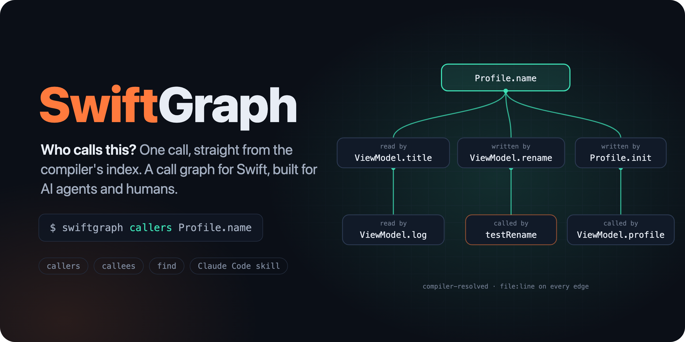

# SwiftGraph



An agent skill and a command-line tool that answer "who calls / reads / writes this?" and "what does this call?" for Swift code in one call. Answers come from the compiler's own index store, so overloads, protocol dispatch and property accesses are resolved the way the compiler resolved them: no text matching, no guessed edges.

```
$ swiftgraph callers Profile.name --depth 2
Profile.name  [instanceProperty]  Sources/Core/Profile.swift:1
├─ read by ViewModel.title  Sources/App/ViewModel.swift:8
│  └─ read by ViewModel.log()  Sources/App/ViewModel.swift:13
├─ written by ViewModel.rename(_:)  Sources/App/ViewModel.swift:9
│  └─ called by ViewModelTests.testRename()  Tests/AppTests/ViewModelTests.swift:3  [test]
└─ written by Profile.init(name:)  Sources/Core/Profile.swift:1
   └─ called by ViewModel.profile  Sources/App/ViewModel.swift:5
… 2 more nodes cut (raise --depth / --limit)
```

## Install the skill

In Claude Code:

```
/plugin marketplace add agruchala/swift-graph
/plugin install swiftgraph@swiftgraph
```

Or clone the repo and link the skill into your personal skills:

```bash
git clone https://github.com/agruchala/swift-graph.git && cd swift-graph
ln -s "$PWD/skills/swiftgraph" ~/.claude/skills/swiftgraph
```

Either way, the skill's `scripts/swiftgraph` wrapper builds the tool from the repo root on first use (about a minute), so nothing else needs installing.

Requirements: macOS with Xcode (the tool loads Xcode's `libIndexStore.dylib`).

## Use the tool directly

```bash
xcrun swift build -c release
```

```bash
$(xcrun swift build -c release --show-bin-path)/swiftgraph callers <symbol>
```

Use `xcrun swift`. A non-Xcode `swift` on `PATH` (e.g. from swiftly) may not match the Xcode SDK.

| Command | What it does |
|---|---|
| `swiftgraph callers <symbol>` | Who calls / reads / writes / references it, transitively |
| `swiftgraph callees <symbol>` | What it calls / reads / writes, transitively (`--refs` adds referenced types and enum cases) |
| `swiftgraph find <text>` | Symbols whose name contains the text |
| `swiftgraph index [--build] [--ci]` | Rebuild the graph from existing index stores, or build first with `--build` |

`<symbol>` is `name`, `Type.name`, `Module.Type.name`, `name(label:)` or a 12-character id from an earlier answer. Ambiguous names list candidates and exit 2 instead of guessing. Other flags: `--depth` (default 3), `--limit` (default 150), `--no-tests`, `--exclude <Module>`, `--repo <path>`.

Exit codes: `0` answer, `1` no match, `2` ambiguous, `3` tool error, `64` bad usage.

## How it works

1. **Index stores:** found automatically. These are Xcode DerivedData folders whose workspace is in the repo, SwiftPM `.build` stores, and `.swiftgraph/DerivedData` from `--build`. `.swiftgraph/config.json` can also list them explicitly.
2. **Extraction:** every Swift file git knows about is read from the store with the newest unit for it. Symbols are types, functions, properties, initializers and enum cases. Edges are calls, reads, writes, type references, and override/conformance links.
3. **Leaves:** system frameworks and blocklisted modules appear only as `[external]` leaves and are never walked into. Calls the compiler inserted itself (result builders, literals, property-wrapper and macro plumbing) are left out.
4. **Storage:** the graph goes to `.swiftgraph/graph.txt` (with `--ci`, meant to be committed) or `.swiftgraph/graph.local.txt` (local, gitignored). It's one sorted, tab-separated record per line, so diffs stay small and the same index gives a byte-identical file.
5. **Queries:** they read the newer of the two files. A line starting with `!` means the graph is older than the code.

### `.swiftgraph/config.json`

All fields are optional:

```json
{
  "blocklist": ["SomeThirdPartyModule"],
  "project": "App.xcodeproj",
  "schemes": [{ "name": "App", "destination": "generic/platform=iOS Simulator" }],
  "stores": ["path/to/index/store"]
}
```

- `blocklist`: modules shown only as leaves.
- `project` + `schemes`: what `index --build` builds with `xcodebuild build-for-testing`. Without them, a Swift package builds with `swift build`.
- `stores`: explicit index store paths. When set, they replace auto-detection.

### Limits

- The graph reflects the last indexed build. Run `swiftgraph index --build` after edits.
- Only links the compiler records are included. `NotificationCenter`, selectors, KVO, SwiftUI environment injection and reflection don't appear.
- macOS with Xcode only.

## Development

```bash
xcrun swift test
```

The tests build a small fixture package in `Tests/Fixtures/Sample` and check extraction against its index.

## License

MIT. See [LICENSE](LICENSE).
